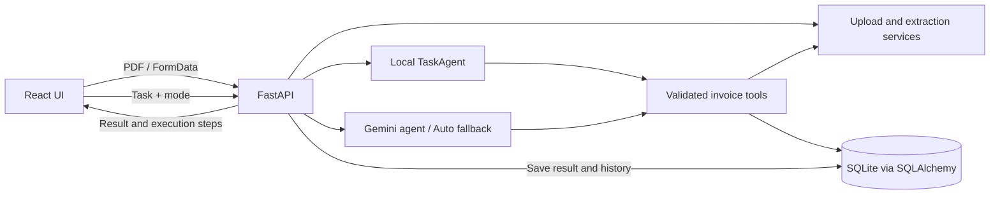

# TaskPilot — Autonomous AI Task Worker

TaskPilot is a local invoice-processing prototype that turns a natural-language
request into an observable, verified workflow. It reduces repetitive invoice
entry while checking the source document and preventing duplicate records.

**Upload PDF → identify vendor → select latest invoice → extract/validate fields
→ search company records → create if missing → verify → save task history.**

This is a development prototype, not a production-ready service. Live Gemini
behavior and production deployment have not been validated by the offline suite.

## Implemented features

- React PDF upload interface: one file, filename/size preview, empty/extension/
  10 MiB validation, loading state, duplicate-submission guard, and useful errors.
- Available-PDF listing refreshes after upload. Original names are cached for the
  browser session; stored UUID names remain backend identifiers.
- Vendor identification and latest-invoice selection use PDF contents and dates,
  not filenames or upload order. Conflicting latest-date invoices need clarification.
- Shared deterministic extraction for Local and Gemini: alternate labels, multiline
  fields, multipage text, normalized dates, and Decimal amount validation.
- Vendor-aware searches, safe duplicate recovery, transaction rollback, and an
  explicit SQLite normalized composite unique index.
- Local, Gemini, and Auto execution; retry demonstration, independent record
  verification, execution timeline, and persisted task history.
- Required-field/conflict checks, bounded extraction, secure PDF basenames/path
  containment, safe access errors, and rejection of unsupported PDFs.
- Request deadlines and retry guidance; bounded concurrency and failure tests.

Uploading stores a PDF only. Invoice records are created through the task workflow
or the explicit invoice-creation API, not automatically during upload.

## Architecture and dependencies



| Area | Libraries / tested versions |
| --- | --- |
| Runtime | Python 3.12.6; Node 22.13.1 |
| API | FastAPI 0.142.4, Uvicorn 0.54.0, Pydantic 2.13.5 |
| Persistence | SQLAlchemy 2.1.4, SQLite (Python standard library) |
| PDFs | PyMuPDF 1.28.2, python-multipart 0.0.33 |
| AI | google-genai 2.29.0; configured model `gemini-3.5-flash` |
| Configuration | python-dotenv 1.2.4 |
| UI | React / React DOM 19.3.0 from lockfile; Vite 8.3.4 |
| Testing | unittest, FastAPI TestClient/httpx 0.28.1, Node test runner, installed Chrome |

Backend direct versions are in `backend/requirements.txt`; the tested dependency
constraints are in `backend/requirements.lock.txt`. The frontend lockfile records
the complete npm dependency resolution. No new UI or browser-test framework is used.

## Windows PowerShell setup

Prerequisites: Git, Python 3.12, Node **22.12 or newer**, and npm. Ensure your selected
`python` is Python 3.12 (`python --version`); use your Python launcher/interpreter
selection if another version is currently on PATH. Browser tests also require an
installed Chrome/Chromium browser; they do not download one.

### 1. Clone and create the environment

```powershell
git clone https://github.com/HarshMaharana08/TaskPilot.git
Set-Location TaskPilot
py -3.12 -m venv .venv
.\.venv\Scripts\Activate.ps1
```

Activation is optional: the commands below explicitly use the environment's Python.
If PowerShell blocks activation, use those executable paths instead of changing
machine-wide execution policy.

### 2. Install backend and test dependencies

```powershell
.\.venv\Scripts\python.exe -m pip install -r backend\requirements-dev.txt -c backend\requirements.lock.txt
.\.venv\Scripts\python.exe -m pip check
```

For application dependencies without the test requirements, substitute
`backend\requirements.txt`. The constraints pin the inspected dependency versions;
platform-specific extras may also be resolved by pip.

### 3. Configure environment variables

```powershell
Copy-Item .env.example .env
```

Leave `GEMINI_API_KEY` empty for Local execution. To use live Gemini, edit `.env`
locally and set your own key. Never put it in React/Vite variables or commit it.
AI client construction is lazy: Local startup needs no credentials; unconfigured
Gemini returns a clear failure, and Auto can fall back to Local.

The default API URL is `http://127.0.0.1:8000`. If needed, set
`VITE_API_BASE_URL` in the frontend's ignored `.env.local`, then restart Vite.
The backend CORS configuration currently permits `localhost:5173` and
`127.0.0.1:5173`; a different frontend origin requires an explicit backend change.

### 4. Initialize SQLite and apply the required migration

Run from the project root:

```powershell
.\.venv\Scripts\python.exe -c "from backend.app.database import Base, engine; import backend.app.models; Base.metadata.create_all(bind=engine)"
.\.venv\Scripts\python.exe backend\migrations\0001_invoice_vendor_uniqueness.py data\taskpilot.db
```

Initialization creates empty tables in `data/taskpilot.db`; existing tables/records
are preserved. `create_all()` does not migrate existing schemas. The standalone
versioned migration requires an explicit existing database path and enforces:

```sql
CREATE UNIQUE INDEX ux_invoices_vendor_invoice_number_normalized
ON invoices (lower(trim(vendor)), invoice_number);
```

The migration checks for duplicates, locks out competing writes during its
transaction, validates any existing index definition, and rolls back on failure.
Running it again reports `already applied`. It is not run automatically at startup.

For an existing database, pause writers and make a verified SQLite backup before
applying a migration. See [developer notes](docs/development.md) for the backup
procedure. Never run reset/demo utilities against records you need to preserve.

### 5. Install and start the frontend/backend

Backend terminal, from the project root:

```powershell
.\.venv\Scripts\python.exe -m uvicorn backend.app.main:app --reload --host 127.0.0.1 --port 8000
```

Frontend terminal:

```powershell
Set-Location frontend
npm.cmd ci
npm.cmd run dev -- --host 127.0.0.1 --port 5173 --strictPort
```

Open `http://127.0.0.1:5173`. API health: `http://127.0.0.1:8000/health`;
interactive documentation: `http://127.0.0.1:8000/docs`.

Neither startup nor testing requires existing invoice PDFs or local database
records. A fresh installation starts with empty company records and history.

## Using TaskPilot

1. Select a text-based invoice PDF in **Invoice PDFs**. Check its name and size,
   then select **Upload PDF**. The list refreshes after success.
2. Enter a task referencing the vendor written in the PDF. For example:
   **Find the latest invoice from Acme Corporation and enter it into the company system.**
3. Select **Local**, **Gemini**, or **Auto**, then run the task.
4. Review the result, verification, and expandable execution timeline.
5. Open **Execution History** to inspect or reopen saved runs. Repeating a task
   can create another history entry but must not duplicate the invoice record.

| Mode | Behavior |
| --- | --- |
| Local | Deterministic invoice processing, no Gemini request |
| Gemini | Model-directed use of the same validated invoice tools; requires a key |
| Auto | Attempts Gemini and falls back to Local for configured quota/unavailable failures, including missing configuration; does not hide permission errors |

The first creation attempt can intentionally fail once per process through the
existing transient-failure simulation. The Local agent retries once and verifies
the saved record. Client timeouts do not cancel server work: check the invoice
list/history before retrying. No automatic network replay is performed.

## Supported invoice text

Required fields: vendor, invoice identifier, invoice date, due date, positive total.

| Field | Supported examples |
| --- | --- |
| Vendor | `Vendor`, `Supplier`, `Seller`, `From`, `Company`, `Billed From`; same/next-line values; conservative company-heading fallback |
| Identifier | `Invoice Number`, `Invoice No.`, `Invoice #`, `Invoice ID`, `Bill Number`, `Bill No.`; qualified invoice references only |
| Dates | `2026-11-05`, `05/11/2026`, `05-11-2026`, `05 Nov 2026`, `November 5, 2026`, `2026/11/05` |
| Total | `Total Amount`, `Invoice Total`, `Grand Total`, `Amount Due`, `Total Due`, `Balance Due` |
| Amounts | `75000`, `75,000`, `75,000.00`, `₹75,000.00`, `INR 75,000.00`, `$1,250.50`, `USD 1,250.50` |

Numeric dates use explicit **day-first DMY**, with warnings for ambiguous values.
Dates normalize to ISO. Identifiers can contain letters, digits, hyphens, slashes,
and underscores. Matching repeated fields are harmless; conflicting values are
errors. Totals are not guessed from subtotal/tax/line-item amounts.

Documents must be readable, unencrypted, undamaged PDFs, at most **10 MiB**,
**200 pages**, and **2,000,000 extracted text characters**. Invalid/incomplete
uploads are rejected. PDF text is untrusted data, not agent instructions.

## Important API contracts

| Method and route | Request / behavior |
| --- | --- |
| `GET /` | API identity |
| `GET /health` | Health status |
| `POST /invoices/upload` | Multipart field **`uploadedFile`**; 201 with `success`, `original_filename`, UUID `filename`, `size_bytes`, `page_count`, `message` |
| `GET /tools/invoices` | Array of stored `{filename, path}` entries |
| `GET /tools/invoices/{filename}` | Read one safe PDF basename; content and deterministic extraction metadata |
| `GET /tools/search/{invoice_number}?vendor=...` | Vendor-aware lookup; omitting vendor can return ambiguity |
| `POST /tools/invoices` | JSON `vendor`, `invoice_number`, `invoice_date`, `due_date`, `amount` |
| `GET /tools/verify/{invoice_number}` | Required query parameters: `vendor`, `invoice_date`, `due_date`, `amount` |
| `POST /tasks` | JSON `{ "task": "Process the latest Acme invoice", "mode": "local" }`; API default mode is `auto`, UI default is Local |
| `GET /tasks/history` | Up to 50 most recent stored tasks/results |

Path-based identifier routes expect a single URL path segment. The task workflow
can handle identifiers containing `/` through its direct tool calls.
Validation errors use 422, invalid execution modes use 400, and unhandled database
availability errors use JSON 503 with retry guidance. PDF failures provide safe
validation messages; tool/business failures can be represented in result bodies.

## Tests and validation

All suites generate synthetic fixtures in temporary storage; they do not depend
on private PDFs, seed the active database, or make live Gemini requests.

From the project root:

```powershell
.\.venv\Scripts\python.exe -B backend\tests\runStep4Tests.py
.\.venv\Scripts\python.exe -B -m unittest discover -s backend/tests -p step6WorkflowTests.py -v
.\.venv\Scripts\python.exe -B -m unittest discover -s backend/tests -p freshInstallSmokeTests.py -v
```

From `frontend/`:

```powershell
npm.cmd test
npm.cmd run test:browser
npm.cmd run lint
npm.cmd run build
```

The migration tests run through `runStep4Tests.py` against a disposable
pre-migration fixture; do not point them at an active database. Browser tests
launch only their own hidden browser/server and temporary SQLite/PDF storage.
Mocked API checks are distinguished from actual browser-to-FastAPI flows in the
[Step 6 report](backend/tests/step6Report.md). Build output and screenshots are ignored.
See [developer notes](docs/development.md) and the [Step 7 report](backend/tests/step7Report.md)
for reproducibility and final validation results.

## Storage, security, and limitations

- Local database, backups, new uploads, `.env`, virtual environments, caches,
  dependencies, and generated outputs are excluded from new commits. Five existing
  synthetic Acme/Globex demo PDFs remain tracked; never add private invoice PDFs.
- Image-only/scanned PDFs need OCR, which is not implemented. Unfamiliar or
  complex layouts may require clarification instead of guessed values.
- Only INR invoices can be persisted safely with the current currency-less ledger.
  Other currencies can be extracted/uploaded but are blocked from agent persistence.
  Bare or legacy unreadable-glyph amounts use the documented legacy INR convention.
- Decimal parsing preserves cents, but the existing database stores binary floats.
  Amounts must be positive, finite, and no greater than 999999999999.99.
- SQLite `lower(trim(vendor))` and Python Unicode `strip().casefold()` do not have
  identical Unicode/whitespace behavior. Current synthetic demo vendors are ASCII.
- Original upload names are session-cached, not persisted for cross-session display.
- Offline mocks do not verify live Gemini model access, quality, latency, or quota.
- Chrome desktop/mobile emulation is tested; other browsers and physical devices
  are not. Production deployment, authentication/authorization hardening, capacity,
  and recovery from process/disk failure are not validated.
- The service is intended for local development. Do not expose it publicly as a
  production service based only on these tests.

No license has been selected. Do not assume redistribution/reuse permission until
the repository owner adds one.
